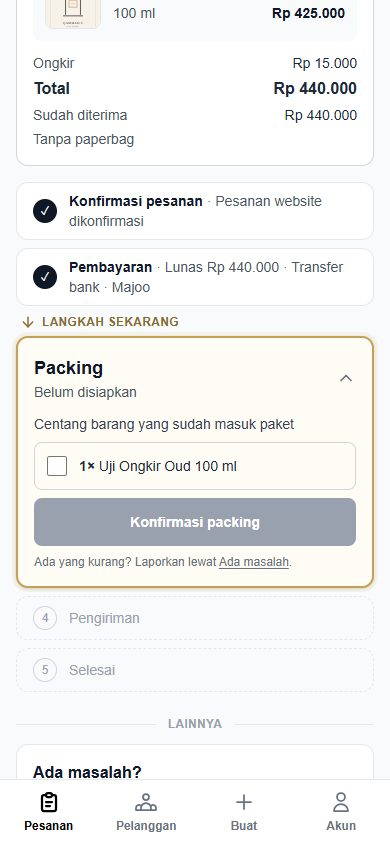
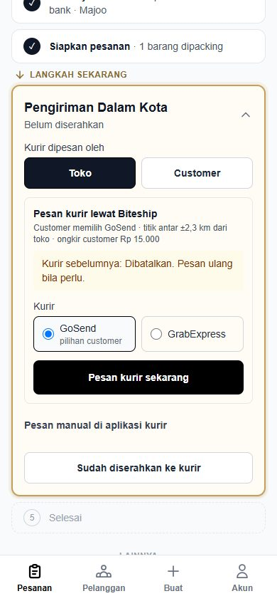
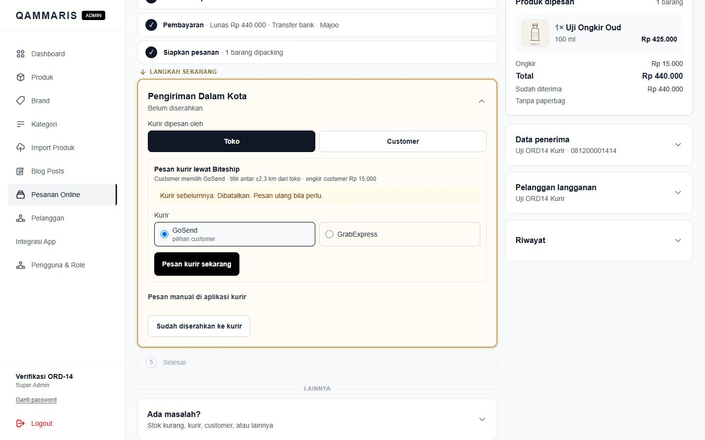
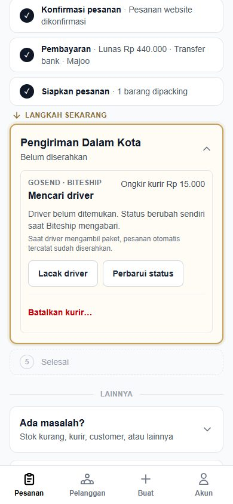
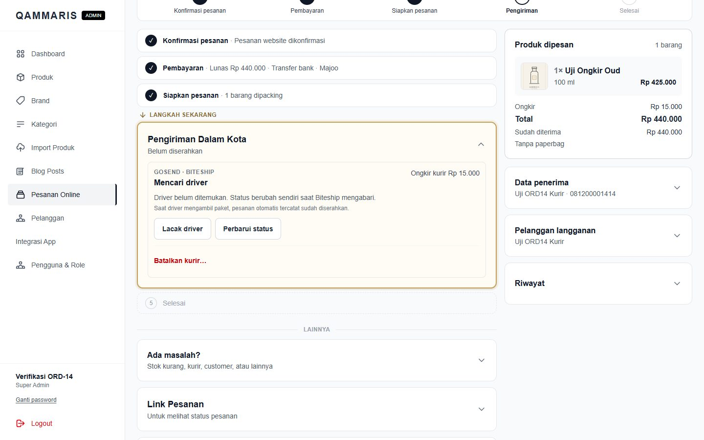
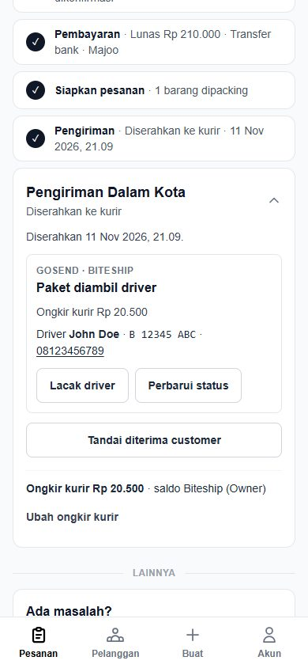
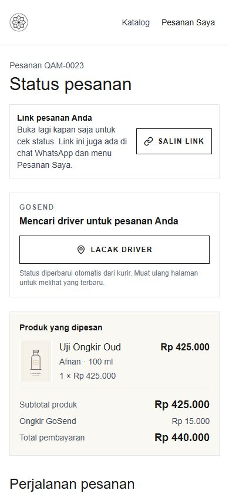
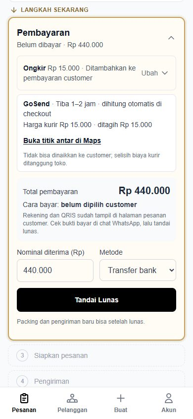
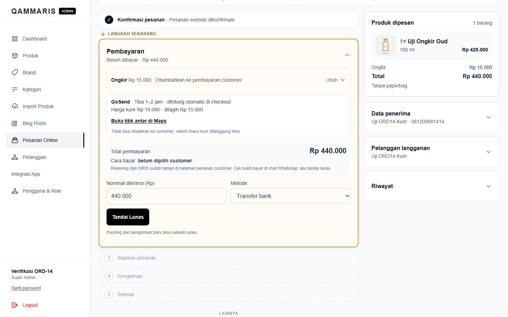

# ORD-14 verification — courier booking through Biteship (local, 2026-11-11)

Branch `ongkir-otomatis`, local server `127.0.0.1:8010`, local SQLite, the Owner's Biteship **test** key (no balance used). Synthetic data only: product "Uji Ongkir Oud" (900026), order QAM-0023 placed through the real checkout (Kurir instan, pin in Palu Timur, GoSend Rp15.000), temporary Super Admin `ord14-verify@example.test` (removed after the check).

## Automated

- `tests/Feature/BiteshipCourierBookingTest.php` (7 tests, 106 assertions, Biteship faked):
  - booking sends the customer's courier, `courier_type=instant`, `reference_id=<code>-1`, the checkout pin and 800 g per item; a second click books nothing;
  - webhook `allocated` saves the driver quietly (same revision) and shows it to staff and the customer (no driver phone, no Sharelok request); `picked` = handover + cost `owner_fund` Rp21.000 reported by "Biteship", event by "Biteship (otomatis)"; `delivered` = received; one cost only;
  - a refusal shows Biteship's reason, keeps the step free, and a retry is attempt 2 (`-2`);
  - `courierNotFound` (camelCase) frees the step; cancel sends the reason and is attributed to the admin; no cost;
  - only packed instant orders with the pin get the button; staff-made orders and the flag off keep the manual form and send nothing;
  - webhook: wrong or missing secret → 404, empty body (Biteship's URL check) → 200, unknown order → 200 without a Biteship call;
  - website order payment card: total, "Cara bayar", no "Salin Total & Instruksi Pembayaran".
  - the booking admin's account removed before pickup: the cost is still recorded, without a recorder.
- `OrderCourierCostTest`: Super Admin sees "Konfirmasi packing".
- Full suite: 854 passed, 10 skipped, 3 failed — the known local-only failures (two J&T QR tests need PHP GD, `ReleaseCheckTest` needs VAPID keys).

## Real Biteship test mode (from the admin page)

1. Konfirmasi pesanan → Tandai Lunas (payment card without the instruction block) → Konfirmasi packing as **Super Admin**.
2. **Pesan kurir sekarang** (GoSend): Biteship accepted, status "Mencari driver", ongkir kurir Rp15.000, tracking link on `track.biteship.com`.
3. **Perbarui status**: re-read from Biteship, still `confirmed`.
4. **Batalkan kurir** with a reason: Biteship reports the order `cancelled`; the step is free again ("Kurir sebelumnya: Dibatalkan").
5. **Pesan kurir sekarang** again with GrabExpress: accepted, Rp11.000 (attempt 2).
6. After the last UI tidy-up (switch hidden while booked, quiet handover fallback, customer's courier always preselected): cancelled again (attempt 3) and booked GoSend again; attempt 4 stays active ("Mencari driver") for the Owner's check.
7. Webhook on the running server: empty body 200, wrong secret 404, a body claiming `allocated` for the real order → 200 and the status stayed `confirmed` (the body is never trusted; the order is re-read).

Biteship dashboard (Owner's Chrome, read-only, 2026-11-11): the Owner's own test order QAM-0022-1 was "Teralokasi" in Shipping → Pesanan, and the admin read it with "Perbarui status" as "Driver ditemukan" (test driver "John Doe", plate "B 12345 ABC"). Its yellow **Update Status** button offers "Start picking up" and "Cancel"; nothing was chosen by the agent. The Owner then moved QAM-0022-1 to pickup in the dashboard; "Perbarui status" recorded the handover by "Biteship (otomatis)" and the courier cost Rp20.500 as Owner funding from the Biteship balance (no reimbursement); the order completed (paid and handed over). Delivered is covered by the automated tests.

## Screenshots

| Before | After |
|---|---|
| Super Admin: "Menunggu packing oleh staf toko" ([ORD-08](../ord-08/round2-owner-3-packing-by-staff.png)) |  |
| Manual "Kurir sudah dipesan" form only ([ORD-08](../ord-08/after-booking-form-390.png)) |   |
| — |   |
| — |  (taken before "Tandai diterima customer" was hidden for Biteship) |
| — (customer page had no courier block) |  |
| Website order payment card with "Salin Total & Instruksi Pembayaran" (unchanged for staff-made orders) |   |

## UX notes

- One primary action per state: "Pesan kurir sekarang" while unbooked; once booked, the status card leads. Owner review 2026-11-11: no "Sudah diserahkan ke kurir" for a Biteship driver (the pickup is the handover; the card says so), none before staff choose Biteship or the manual path, and no "Tandai diterima customer" while Biteship delivers.
- The customer's courier is preselected and labelled "pilihan customer"; the other stays one tap away for a driver-not-found retry.
- The "Toko / Customer" switch is hidden while a Biteship driver is booked (cancel first), so staff cannot pick a state the server refuses.
- The customer sees plain Indonesian statuses and "Lacak driver"; the driver's phone stays with staff.
