# ORD-15 verification — courier/bank logos and automatic cancellation of unpaid orders (local, 2026-11-11)

Branch `logo-batas-bayar`, local server `127.0.0.1:8010`, Biteship test key. Synthetic data only (product "Uji Ongkir Oud", order QAM-0020); the temporary admin used for the admin screenshots was removed.

## Logos

Public-domain files from Wikimedia Commons ([licences](../../licenses/partner-logos.txt)):
- checkout: Gojek and Grab beside "Kurir instan", J&T beside "J&T";
- each priced courier card: the logo of its courier;
- the BRI account: the real BRI logo (other banks keep the colour mark).

| Before | After |
|---|---|
| 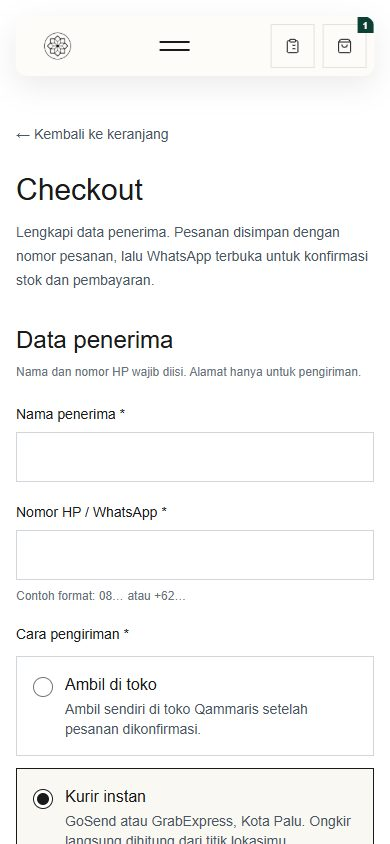 | 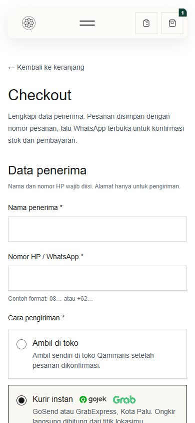 |
| 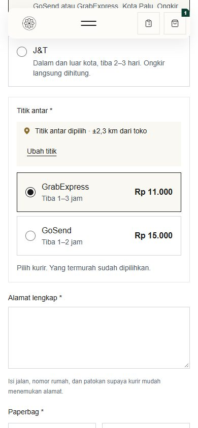 | 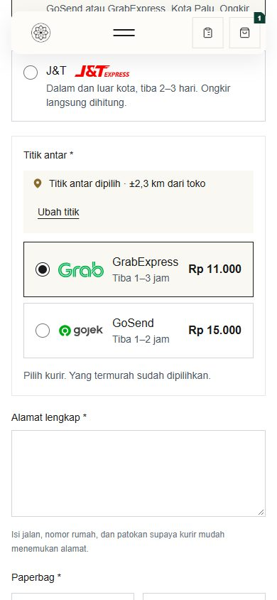 |
| 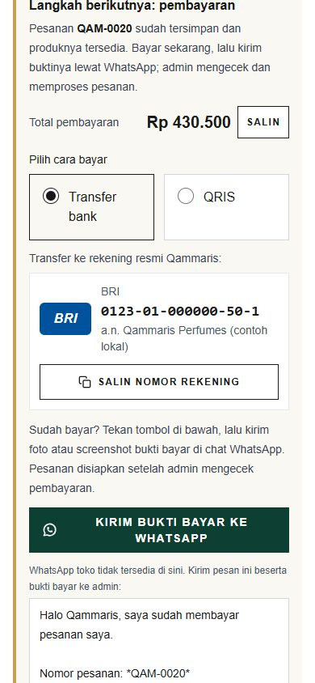 | 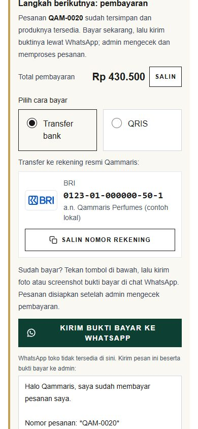 |
| 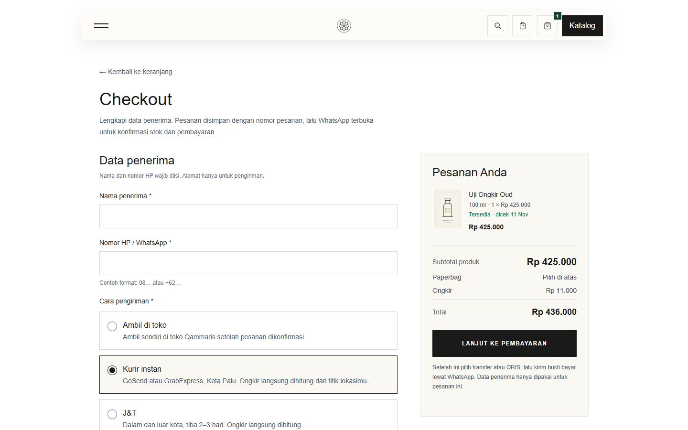 | 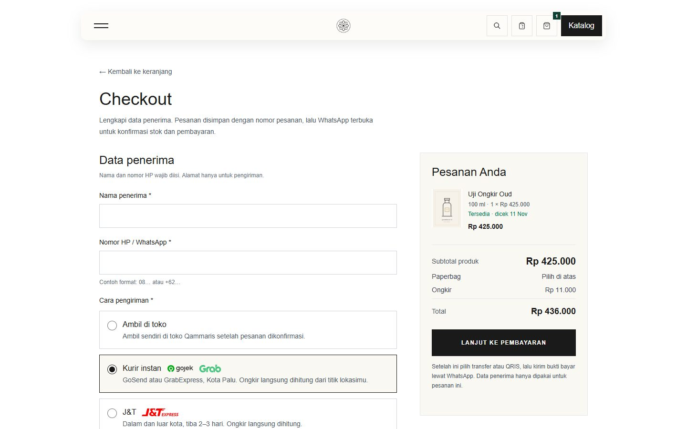 |
| 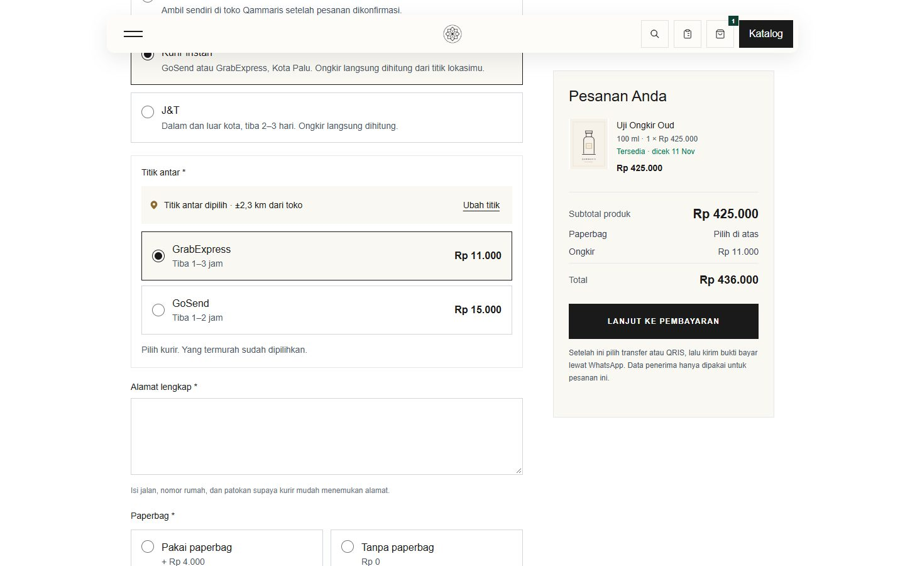 | 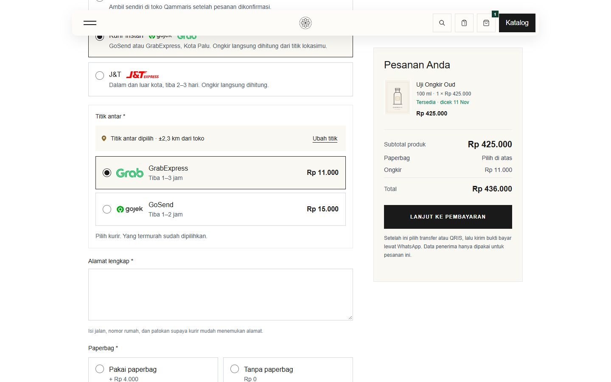 |
| 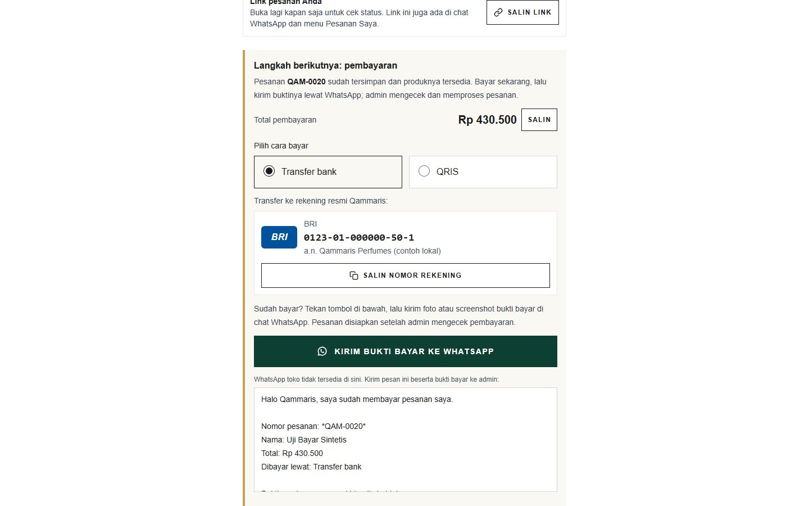 | 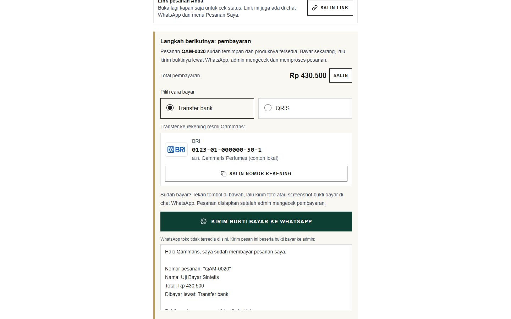 |

## Automatic cancellation after 48 hours unpaid

- `qammaris:orders:expire-unpaid` (scheduler, every 5 minutes):
  - sets `payment_due_at` = 48 hours after an order first becomes payable;
  - clears the deadline when the order stops being payable;
  - cancels orders past the deadline, as "Sistem (otomatis)".
- Run locally: QAM-0020 (payable before confirmation) got its deadline.
- The customer page says "Bayar sebelum Jumat, 13 Nov 2026, 22.40 WITA. Lewat dari itu, pesanan dibatalkan otomatis." The admin shows "Batal otomatis bila belum dibayar sampai …" in the confirmation and payment cards.
- Tests (`UnpaidOrderExpiryTest`, 4):
  - deadline set, not cancelled at 47 h, cancelled at 49 h;
  - a partial payment, an active keep, or a total that is not final keeps the order;
  - paying in time keeps it;
  - `ORDERS_UNPAID_CANCEL_HOURS=0` switches it off.

| Customer | Admin |
|---|---|
| 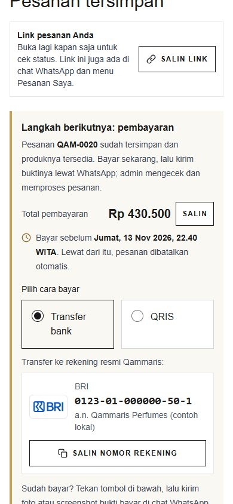 | 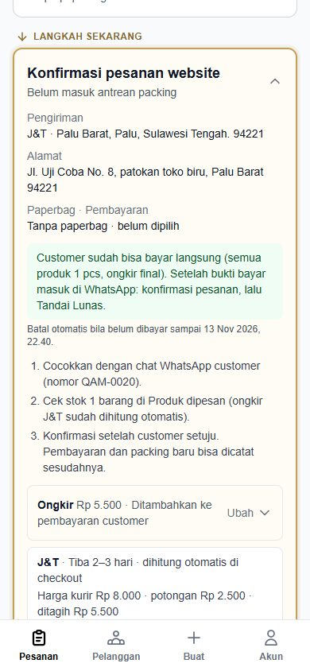 |

Full suite: 861 passed, 10 skipped, 3 known local-only failures; JS 103 passed; build OK.
