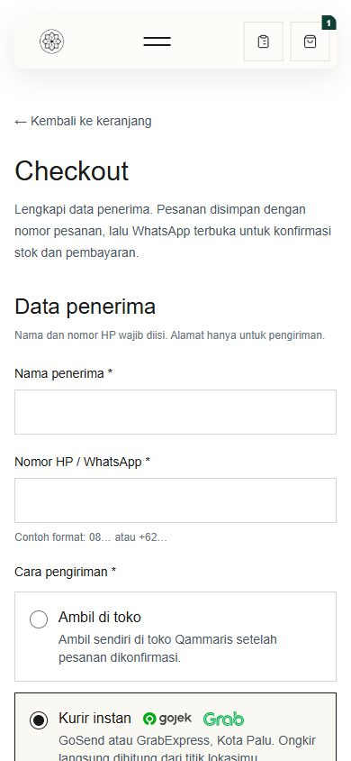
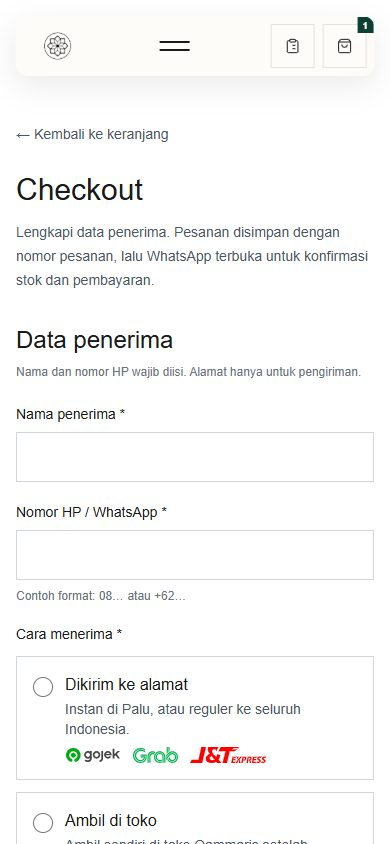
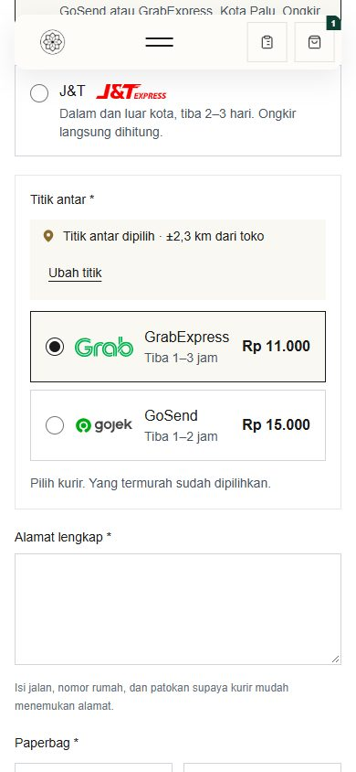
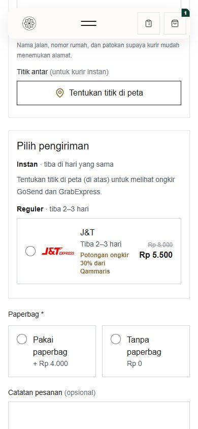
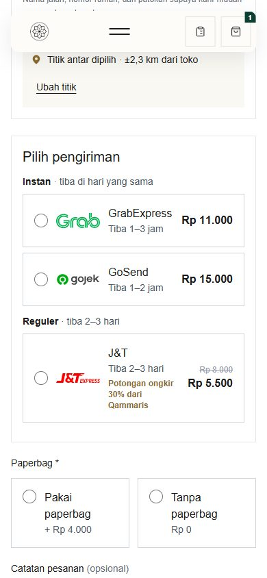
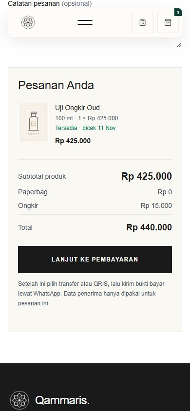
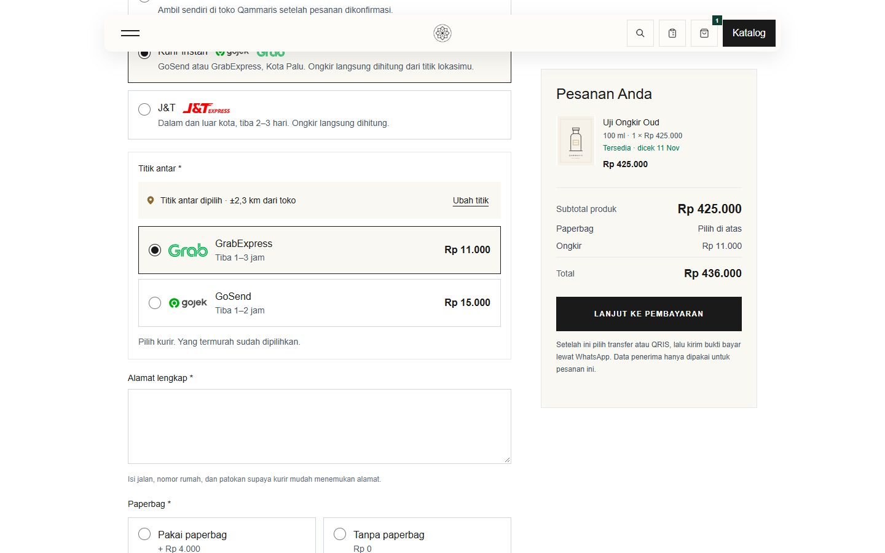
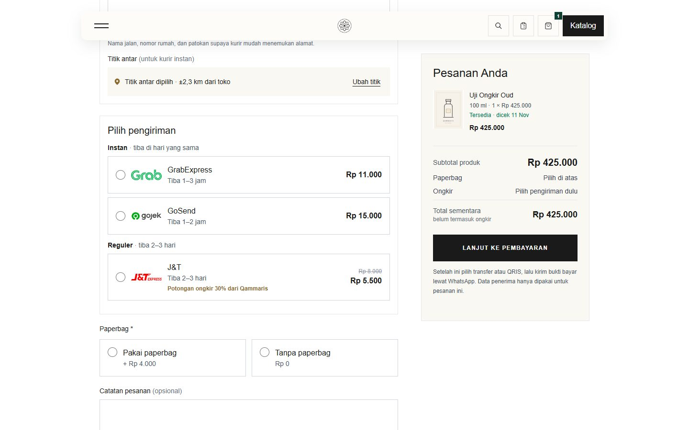

# ORD-16 verification — checkout in marketplace order (local, 2026-11-11)

Owner request: "rapikan flow checkout" like Shopee/Tokopedia: the address first, then the shipping options. Common pattern checked: address, then shipping grouped by duration (Instan, Reguler) with the courier and price, then payment ([Shopee guide](https://shopee.co.id/inspirasi-shopee/ingin-tahu-cara-belanja-di-shopee-yuk-ikuti-langkahnya/amp/), [Tokopedia Beli Langsung](https://www.tokopedia.com/help/article/beli-langsung)).

## New order on the page (with automatic ongkir on)

1. Data penerima (nama, HP).
2. **Cara menerima:** *Dikirim ke alamat* (Gojek, Grab and J&T logos) or *Ambil di toko*.
3. **Alamat pengiriman:**
   - kecamatan or city (Biteship area search);
   - alamat lengkap;
   - for Palu, Sigi and Donggala, the map pin (for instant couriers only).
4. **Pilih pengiriman:** **Instan** (GoSend, GrabExpress, after the pin) and **Reguler** (J&T, priced as soon as the area is chosen), each with logo, ETA and discount. Nothing is preselected; the order's delivery type follows the chosen option.
5. Paperbag, note, summary; payment on the next page as before.

The old flow (switch off) is unchanged.

## Checks

- Headless Chrome against the local server with the Biteship test key:
  - "Palu Timur" → J&T Rp5.500 (struck Rp8.000);
  - pin → GrabExpress Rp11.000 and GoSend Rp15.000;
  - GoSend chosen → delivery `local_delivery`, summary Rp15.000, button "Lanjut ke pembayaran".
- The submitted order QAM-0024 is instant GoSend Rp15.000 with kecamatan "Palu Timur" and postcode 94111. The area label is taken from the session's own Biteship search, never from the browser.
- Tests:
  - `CheckoutShippingQuoteTest` (layout order, the hidden delivery field, kecamatan/postcode from the searched area);
  - JS `instantArea`, `deliveryFor`, `kecamatanCenter`.
- Full suite: 861 passed, 10 skipped, 3 known local-only failures. JS: 106 passed. Build OK.

| Before (ORD-15) | After |
|---|---|
|  |  |
|  |   |
| — |  |
|  |  |
