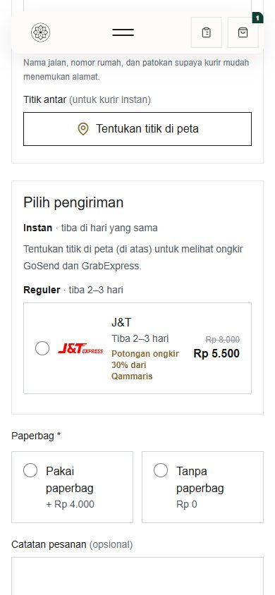
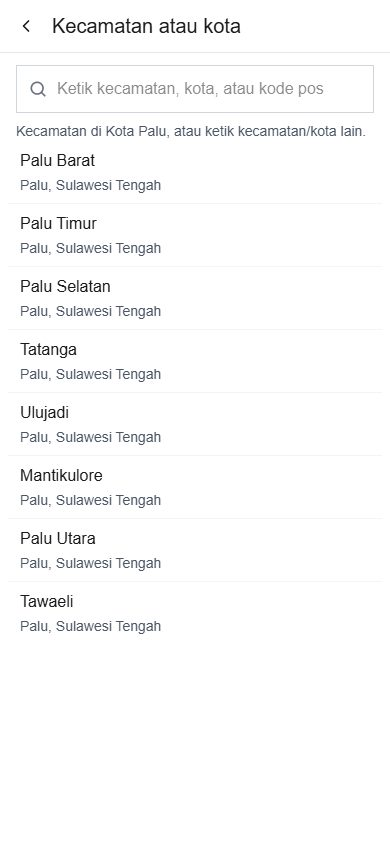
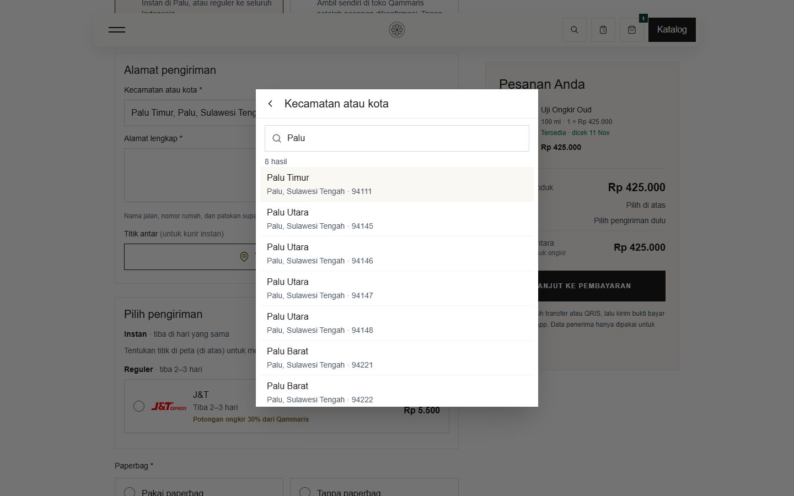
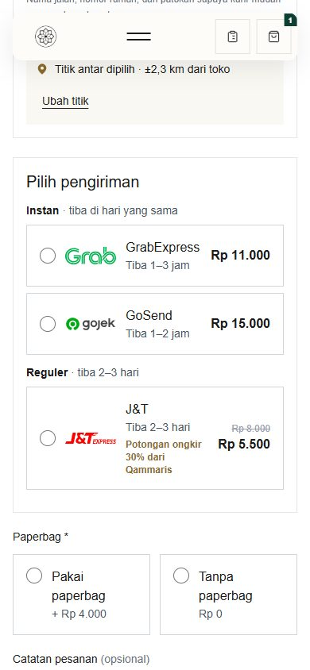
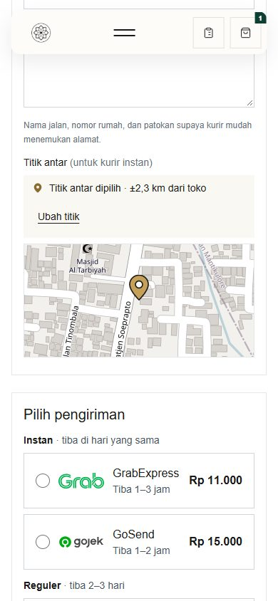
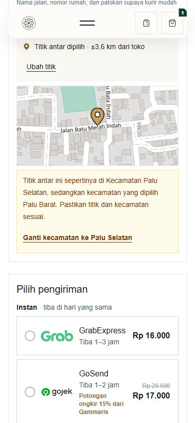
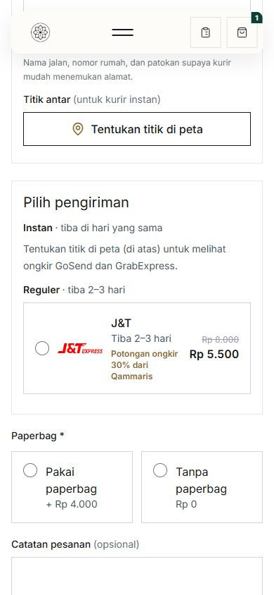

# ORD-17 verification — area search screen, pin preview and kecamatan check (local, 2026-11-11)

Owner feedback on ORD-16 (2026-11-11):
- the keyboard's Search key jumped to the top of the page;
- the list did not come back without typing again;
- searching "Palu" took seconds;
- the pin had no small map;
- what happens when the pin is in another kecamatan than the chosen one;
- "Cara menerima" should read "Metode pengiriman".

## Change

- **Metode pengiriman** label.
- **Kecamatan/kota field opens our own search screen:** full screen on phones, a centred panel on wider screens.
  - Before typing it lists the eight Palu kecamatan as quick picks; one tap takes the exact Biteship area.
  - "Mencari…" shows at once.
  - Results read in two lines (kecamatan, then city · postcode), with the first one highlighted.
  - The keyboard's Search/Enter picks it, or picks the first result as soon as the search answers. It never sends the checkout form.
  - Searches are kept in the page and cached on the server for 30 days, so a repeated search (any case or spacing) answers at once without another paid Biteship call.
  - Built in Blade/vanilla JS in the Qammaris style. 21st.dev components are React, which this site does not use, so they were a reference only.
- **Map place search:** the same behaviour ("Mencari…" at once, Enter picks the first result, the list comes back on tap).
- **Pin preview:** after "Pakai titik ini" a small still map (zoom 17, pin in the middle) sits under "Titik antar dipilih", and shows again after a failed submit.
- **Kecamatan check, a hint only:** the server asks OpenStreetMap (Nominatim, rounded coordinates, cached 30 days) which kecamatan the pin is in.
  - A warning with "Ganti kecamatan ke …" appears only when OpenStreetMap **and** the nearest Palu kecamatan centre both point to another kecamatan than the chosen one.
  - The customer decides; instant prices always use the pin.
  - Automatic replacement was dropped after testing: OpenStreetMap reads Balaroa, next to the store, as Ulujadi while Biteship says Palu Barat.

## Checks (headless Chrome, local, Biteship test key)

| Check | Result |
|---|---|
| Open the field | The search screen with 8 quick picks |
| Type "Palu Timur" and press Enter at once | "Mencari…", then Palu Timur chosen, screen closed, no jump to the top, J&T priced |
| Type "Palu" again | "8 hasil" in two lines with postcodes |
| Pin in Palu Timur | Small map shown, no warning, GrabExpress Rp11.000 / GoSend Rp15.000 |
| Palu Barat chosen, pin moved to Palu Selatan | Warning "Titik antar ini sepertinya di Kecamatan Palu Selatan…"; "Ganti kecamatan ke Palu Selatan" switched the area and the warning closed |

Tests:
- `CheckoutShippingQuoteTest`: layout, a cached area search sends a single Biteship request, the pin endpoint (one Nominatim call, our User-Agent, refused outside the area);
- JS: `areaParts`, `exactArea`, `pinWarning`/`nearestKecamatan`.

Full suite: 862 passed, 10 skipped, 3 known local-only failures. JS: 109 passed. Build OK.

| Before (ORD-16) | After |
|---|---|
|  |   |
|  |   |

## Live (qammarisparfum.id, after PR #169)

One available product in the cart, "Dikirim ke alamat":

- the label reads "Metode pengiriman" and the search screen opened with 8 quick picks;
- typing "Palu Barat" and pressing Enter at once picked Palu Barat and priced J&T from Biteship live;
- the pin endpoint answered "Palu Selatan" for a Palu Selatan point.

The cart was cleared and no order was placed.

