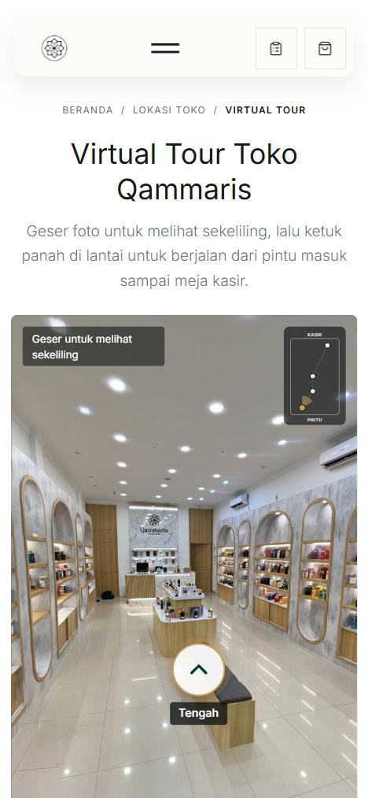
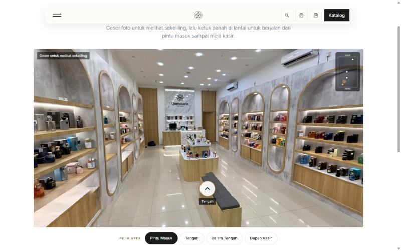
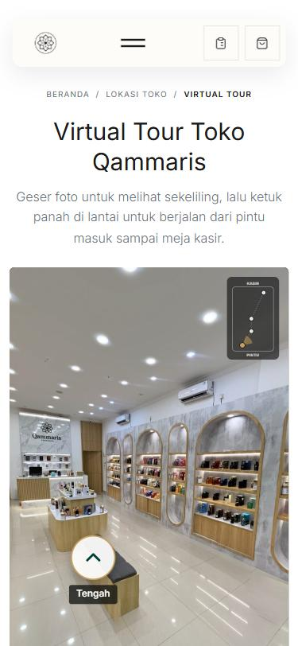

# TOUR-01 — Walkable 360 store tour: local verification

Date: 2026-10-27. Branch `modernization/tour-01-virtual-tour`. Card #128. Decision: [ADR-054](../../architecture/decisions/ADR-054-store-virtual-tour.md).

## Source photos

Seven Teleport 360 captures shared by the Owner (share links, full resolution 9088–10352 px wide). Retouched outside the repository; originals and full-resolution results stay on the Owner's laptop (`virtual-tour-foto/asli`, `virtual-tour-foto/hasil`), not in Git.

| Area | Capture | Main repairs | Known limit |
|---|---|---|---|
| Pintu Masuk | Qammaris 3 (second share) | photographer's reflection in the glass, feet (logo disc), ceiling light swirls | folding gate right of the glass still bent; the glass patch is soft when zoomed |
| Tengah | Qammaris Tengah | ceiling swirls, broken nadir (logo disc), ghost bench | small tile-line breaks on the floor; staff member at the counter |
| Dalam Tengah | Qammaris Dalam Tengah (first of two) | rebuilt lower cabinet of the large left arch, ghost bench, ceiling | display-table end next to the camera cut by the logo disc; rebuilt doors are a reconstruction |
| Depan Kasir | Qammaris Depan Kasir | rebuilt slatted counter front and marble edge, both narrow arch bottoms, MUST TRY cabinet, ghost marble on the floor, ceiling | rebuilt lower parts are reconstructions; doubled trim at the foot of the marble panel |

Not used: Qammaris 1 (display wall too broken, reshoot from 1.5–2 m), the second Dalam Tengah capture, the earlier Qammaris 3 capture.

Walk directions come from relative camera poses (SIFT matches on 24 views per panorama, essential matrix on bearing vectors; 186–2300 inliers per pair). Order from the door: Pintu Masuk → Tengah → Dalam Tengah → Depan Kasir, consistent with the capture names. Reported arrow yaws agree with the solved layout within ~5° except Dalam Tengah ↔ Pintu Masuk (not linked).

## Checks run

- `php artisan test --filter='StoreVirtualTourTest|SeoTechnicalTest|SeoLocalPaluTest|StoreAboutTest'`: 18 passed (255 assertions). `StoreVirtualTourTest` covers the page, JSON data, canonical/breadcrumb, image files and 2:1 size, two-way links, location/footer/sitemap links.
- Full suite (local XAMPP PHP): 822 passed, 10 skipped, 3 failed. The 3 failures (`OrderApiWriteTest` and `OrderOperationalUxTest` J&T QR uploads: GD not installed; `ReleaseCheckTest` everything-ready) fail identically on `main` with these changes stashed.
- Pint (changed PHP), `git diff --check`, `npm run build`.
- Browser, local `artisan serve` + built assets:
  - 390×844 and 375×812 (mobile preset): page width equals viewport, viewer loads the 4096 px files, floor plan top right, walk arrow visible; pointer-event drag (touch type) turns the view and hides the hint; walking Pintu Masuk → Tengah → Dalam Tengah → Depan Kasir and back, then the "Depan Kasir" area button: every step updates the live region, pressed button and arrows, no error state, no console errors.
  - 1440×900: viewer loads the 6144 px files, layout as shown below.
  - Fallback: stage hidden and preview grid shown (4 photos, 4 columns at 1440); the no-JS path uses the same markup through `<noscript>`.

| | |
|---|---|
|  |  |
| 390×844, start at Pintu Masuk | 1440×900 |
|  | |
| 375×812 after a drag | |

Before: the page did not exist (404); `/store/location` gained one sentence linking the tour, the footer "Jelajahi" list one link.

## Not verified

- Genuine touch on a physical iPhone Safari or Android phone (the browser pane sends mouse clicks; drag was simulated with touch-type pointer events).
- Low-end Android GPUs and memory pressure with two 4096 px panoramas during the cross-fade.
- Production CDN caching of the panorama files.
