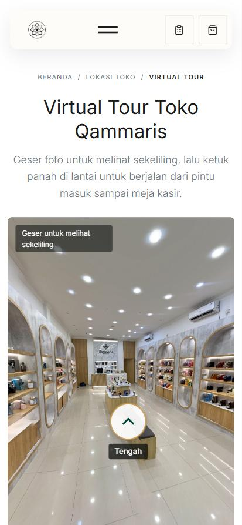
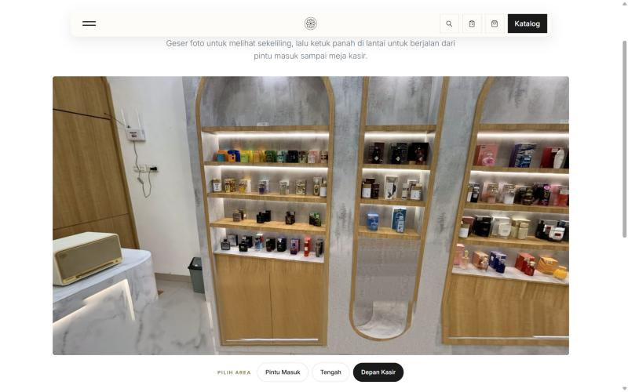

# TOUR-01 — Walkable 360 store tour: local verification

Date: 2026-10-27. Branch `modernization/tour-01-virtual-tour`. Card #128. Decision: [ADR-054](../../architecture/decisions/ADR-054-store-virtual-tour.md).

## Source photos

Teleport 360 captures shared by the Owner (share links, full resolution 9088–10352 px wide). Retouched outside the repository; the three final full-resolution panoramas stay on the Owner's laptop (`virtual-tour-foto/hasil`: `1-pintu-masuk.jpg`, `2-tengah.jpg`, `3-depan-kasir.jpg`), not in Git.

| Area | Main repairs | Known limit |
|---|---|---|
| Pintu Masuk | photographer's reflection in the glass, feet (logo disc), ceiling light swirls; second pass: the last narrow capsule on the side wall straightened (right trim kinked below the last shelf) | folding gate right of the glass still bent; the glass patch is soft when zoomed |
| Tengah | ceiling swirls, broken nadir (logo disc), ghost bench | small tile-line breaks on the floor; staff member at the counter |
| Depan Kasir | rebuilt slatted counter front and marble edge, both narrow arch bottoms, ghost marble on the floor, ceiling; second pass: MUST TRY cabinet rebuilt from the big arch cabinet's real wood (two doors, real aluminium strip) and the narrow capsule bottom copied from the intact capsule on the same wall | rebuilt lower parts are reconstructions; doubled trim at the foot of the marble panel |

Owner review 2026-10-27 (three screenshots): the MUST TRY cabinet looked drawn, the narrow capsule bottom was lumpy, the last Pintu Masuk capsule was skewed. All three repaired as above. The Owner dropped Dalam Tengah ("berantakan"); the tour is Pintu Masuk → Tengah → Depan Kasir. The Owner may still colour-grade the three photos externally and send them back.

Not used: Dalam Tengah (both captures), Qammaris 1 (display wall too broken, reshoot from 1.5–2 m), the earlier Qammaris 3 capture.

Walk directions come from relative camera poses (SIFT matches on 24 views per panorama, essential matrix on bearing vectors; 186–2300 inliers per pair). Tengah → Depan Kasir uses the direct pair estimate (348 inliers; its two directions agree within 2° with the other pairs).

## Checks run

- `php artisan test --filter=StoreVirtualTourTest`: 3 passed (53 assertions): page, JSON data in walking order without Dalam Tengah, canonical/breadcrumb, image files and 2:1 size, two-way links, location/footer/sitemap links. With the related store/SEO tests on the first pass: 18 passed.
- Full suite (local XAMPP PHP, first pass): 822 passed, 10 skipped, 3 failed. The 3 failures (`OrderApiWriteTest` and `OrderOperationalUxTest` J&T QR uploads: GD not installed; `ReleaseCheckTest` everything-ready) fail identically on `main` with these changes stashed.
- Pint (changed PHP), `git diff --check`, `npm run build`.
- Browser, local `artisan serve` + built assets:
  - 375×812 (mobile preset): page width equals viewport, no floor plan, wider start view (90° horizontal, both side walls visible), 4096 px files; walking Pintu Masuk → Tengah → Depan Kasir → Tengah → Pintu Masuk → Tengah plus the "Depan Kasir" area button: live region, pressed button and arrows update, no error state. Area buttons are 44 px high.
  - 1440×900: 6144 px files; MUST TRY cabinet and capsule checked from the Depan Kasir view.
  - Fallback: stage hidden and the preview grid shown; the no-JS path uses the same markup through `<noscript>`.
  - The only console error seen was from a synthetic pointer event in an earlier test run (before the `setPointerCapture` guard was built in).

| | |
|---|---|
|  |  |
| 375×812, start at Pintu Masuk | 1440×900, Depan Kasir MUST TRY wall |
|  |  |
| Pintu Masuk capsule, before / after | 1440×900 start (first pass, with the since removed floor plan) |

Before: the page did not exist (404); `/store/location` gained one sentence linking the tour, the footer "Jelajahi" list one link.

## Not verified

- Genuine touch on a physical iPhone Safari or Android phone (the browser pane sends mouse clicks; drag was simulated with touch-type pointer events).
- Low-end Android GPUs and memory pressure with two 4096 px panoramas during the cross-fade.
- Production CDN caching of the panorama files.
