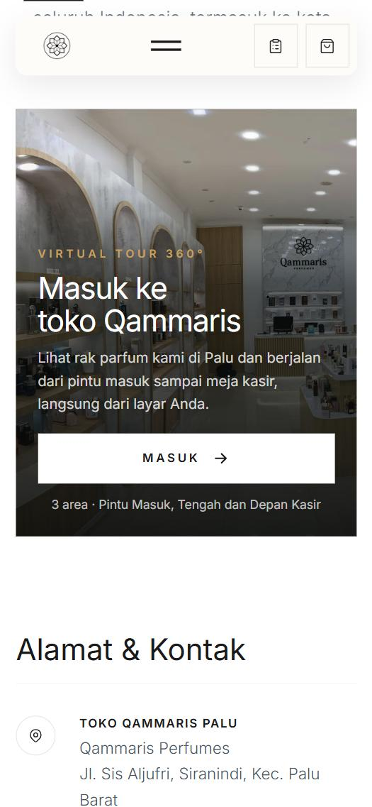
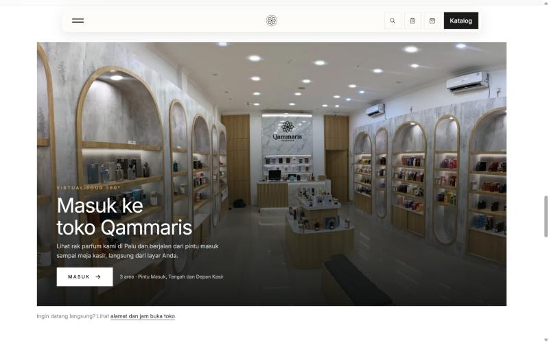
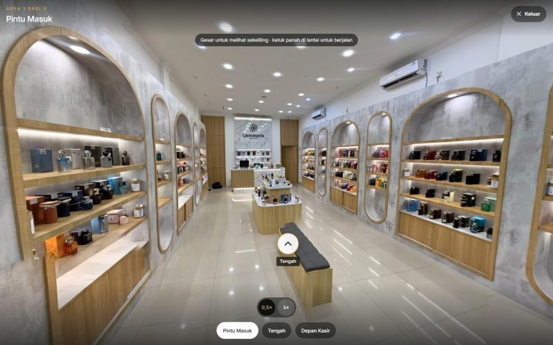
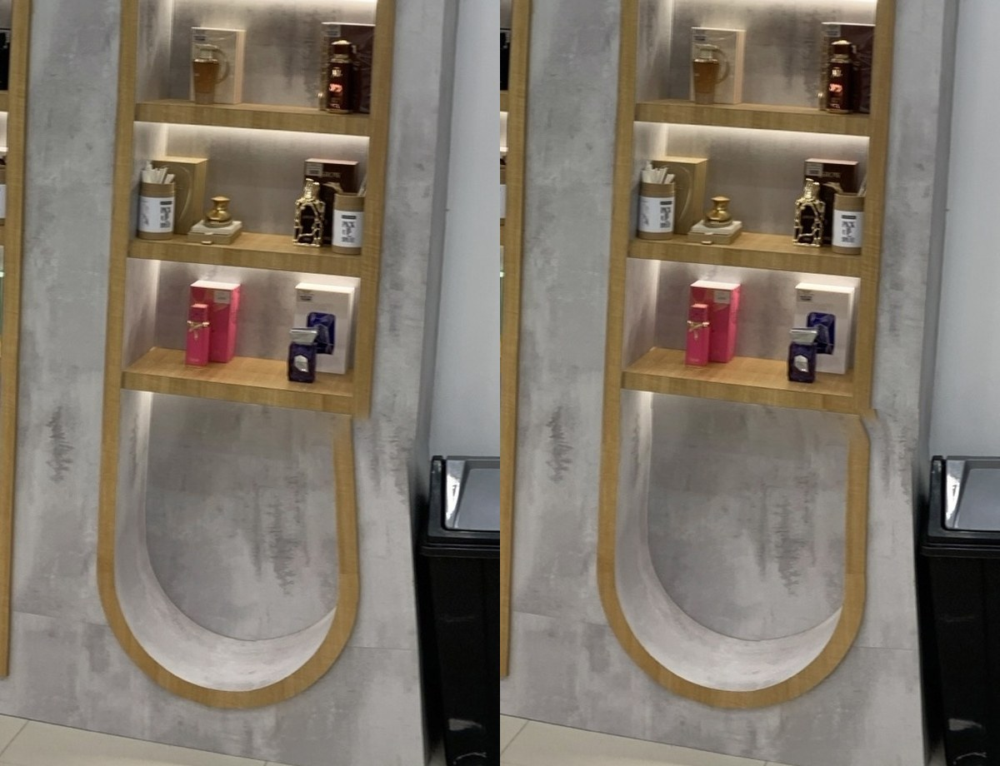

# TOUR-01 — Walkable 360 store tour: local verification

Date: 2026-10-27. Branch `modernization/tour-01-virtual-tour`. Card #128. Decision: [ADR-054](../../architecture/decisions/ADR-054-store-virtual-tour.md).

## Source photos

Teleport 360 captures shared by the Owner (share links, full resolution 9088–10352 px wide). Retouched outside the repository; the three final full-resolution panoramas stay on the Owner's laptop (`virtual-tour-foto/hasil`: `1-pintu-masuk.jpg`, `2-tengah.jpg`, `3-depan-kasir.jpg`), not in Git. The Owner tried colour grading in ChatGPT and dropped it (it altered the content).

| Area | Main repairs | Known limit |
|---|---|---|
| Pintu Masuk | photographer's reflection in the glass, feet (logo disc), ceiling light swirls, the last narrow capsule on the side wall straightened | folding gate right of the glass still bent; the glass patch is soft when zoomed |
| Tengah | ceiling swirls, broken nadir (logo disc), ghost bench | small tile-line breaks on the floor; staff member at the counter |
| Depan Kasir | rebuilt slatted counter front and marble edge, both narrow arch bottoms, ghost marble on the floor, ceiling, MUST TRY cabinet from the big arch cabinet's real wood, narrow capsule bottom from the intact capsule on the same wall | rebuilt lower parts are reconstructions; doubled trim at the foot of the marble panel |

Not used: Dalam Tengah (both captures, dropped by the Owner), Qammaris 1 (display wall too broken, reshoot from 1.5–2 m), the earlier Qammaris 3 capture.

Walk directions come from relative camera poses (SIFT matches on 24 views per panorama, essential matrix on bearing vectors; 186–2300 inliers per pair).

## Review history

1. First pass: separate page `/store/virtual-tour`, four areas, floor plan.
2. Owner review 1 (three screenshots): MUST TRY cabinet looked drawn, a lumpy capsule bottom, a skewed Pintu Masuk capsule; drop Dalam Tengah; phone-first; no map. Repaired.
3. Owner review 2: no page of its own; the tour on the store location page and on the homepage above Qammaris Journal; visitors enter it; camera starts at 0,5. Implemented as `<x-virtual-tour>` with a full-screen dialog.

## Checks run

- `php artisan test --filter=StoreVirtualTourTest`: 4 passed (59 assertions): cover/dialog/zoom buttons/JSON data on `/store/location`; homepage tour between "How it goes" and Qammaris Journal, once; `/store/virtual-tour` 404 and absent from the sitemap, location page links `#virtual-tour`; image files, 2:1 size, two-way links. With the store/SEO/home tests: 21 passed (271 assertions).
- Full suite (local XAMPP PHP, first pass): 822 passed, 10 skipped, 3 failed. The 3 failures (`OrderApiWriteTest` and `OrderOperationalUxTest` J&T QR uploads: GD not installed; `ReleaseCheckTest` everything-ready) fail identically on `main` with these changes stashed.
- Pint (changed PHP), `node --check` on both scripts, `npm run build` (entry 2.08 kB, viewer 8.22 kB, three.js split out).
- Browser, local `artisan serve` + built assets:
  - 375×812 and 390×844, `/store/location`: page width equals viewport; before "Masuk" only the cover image, CSS and the 2 KB script load. "Masuk": dialog 100% of the viewport, page scroll locked, history entry pushed; the walk-in photo hands over at 0,8× and opens to 0,5×; zoom buttons 0,5×/1× toggle; walk Pintu Masuk → Tengah → Depan Kasir → Tengah, area button back to Pintu Masuk; Keluar closes (canvas removed, scroll unlocked, history entry gone); reopen works; `history.back()` (phone back) closes the tour and stays on the page.
  - 1440×900, homepage: cover right above Qammaris Journal, panning; tour opens at 0,5× with the 6144 px files.
  - Screenshots of the open dialog at phone sizes are cropped by the browser pane's capture of top-layer elements; element positions were checked with `getBoundingClientRect`/`elementFromPoint` instead (area buttons at the bottom, Keluar top right).

| | |
|---|---|
|  |  |
| 375×812, store location page | 1440×900, homepage above Qammaris Journal |
|  |  |
| 1440×900, tour open at 0,5× | Pintu Masuk capsule, before / after |

## Production (PR #129, `290f2ac`)

CI and "Production release" passed. Live, public GET only: `/store/location` and `/` 200 with the tour (homepage order "How it goes" → tour → Qammaris Journal), `/store/virtual-tour` 404, sitemap without it, cover/intro/preview/assets 200.

Finding: the Hostinger CDN (`server: hcdn`) resized the JPEG panoramas: 1600×800 for a desktop or no user agent, 800×400 for an iPhone user agent, also converted to WebP when the browser accepts it. WebP originals pass unchanged (`cover.webp` 2400×992 and `intro.webp` 1400×1400 byte-identical, also for an iPhone user agent). Fix: panoramas re-encoded from the full-resolution results as WebP quality 80 (PSNR 40 dB against the previous JPEGs, 3.2 MB total). Local walk Pintu Masuk → Tengah → Depan Kasir → Tengah → Pintu Masuk with the WebP files passed (with reduced motion, because the hidden browser pane paused animation frames).

## Production after the WebP fix (PR #130, `b61fcd1`)

CI and "Production release" passed. Public GET only:

- All six panoramas downloaded with iPhone, Android and desktop user agents (and `Accept: image/webp`): 4096×2048 / 6144×3072 WebP, byte sizes equal to the repository files (316–637 KB).
- `/store/location` and `/` reference only the `.webp` panoramas; `/images/virtual-tour/pintu-masuk-4096.jpg` answers 404.
- Live `/store/location` at 375×812 in the browser pane: "Masuk" opened the tour at 0,5×, walked Pintu Masuk → Tengah → Depan Kasir with the WebP files (motion reduced because the hidden pane pauses animation frames), no console errors.
- `three.module-*.js` is served brotli-compressed (175 KB on the wire, 719 KB decoded), loaded only after "Masuk".

## Not verified

- Genuine touch on a physical iPhone Safari or Android phone, and the Android hardware back button (simulated with `history.back()`).
- Low-end Android GPUs and memory pressure with two 4096 px panoramas during the cross-fade.
- Production CDN caching of the panorama files.
